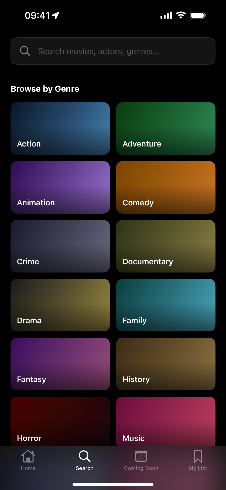

# Cineverse

**A focused proof of the architecture, testing discipline, and Swift stack I bring to large iOS codebases.**

Pedro Pieragnoli — iOS engineer, 5 years. 4.5 of them at enterprise scale on the Itaú banking app, via IBM.
Open to remote iOS roles, contract or full-time — Brazil and global.


<!-- MEDIA PENDING. Drop hero.gif, home.png, search.png, detail.png and accessibility.png
     into docs/media/, then delete this wrapper line and the closing one below.
     The markup between them is final. Capture guidance: readme publication spec, section 4 L3.

<p align="center">
  
</p>

## Demo

| Home | Search | Detail |
|:-:|:-:|:-:|
|  |  |  |

Accessibility pass (VoiceOver on Detail): 

-->

## Highlights

Each bullet pairs a capability with the technique and links to the code.

- **MVVM + protocol-driven data layer.** Every feature ships a `Repository` protocol, a
  `Default*Repository`, a `*RemoteDataSource`, and a `Preview*Repository`, so views, view-models,
  and tests swap implementations cleanly. → [`Features/Detail/Data/`](Cineverse/Features/Detail/Data)
- **Hand-rolled, testable networking core.** No third-party HTTP dependency: `HTTPClient` protocol,
  `URLSessionHTTPClient`, `TMDBRequestBuilder`, `TMDBEnvironment`, typed `TMDBNetworkingError`,
  `APIRequest`. Exercised with an `HTTPClientSpy`. → [`Shared/Networking/`](Cineverse/Shared/Networking)
- **Pure-logic policies, unit-tested.** Visibility and transition decisions live in `*Policy` types
  with zero SwiftUI imports, testable without a UI. →
  [`Features/Detail/Models/DetailOverviewToggleVisibilityPolicy.swift`](Cineverse/Features/Detail/Models/DetailOverviewToggleVisibilityPolicy.swift)
- **Design system as code.** `DesignSystem.swift` is the single source of truth for color, radius,
  spacing, and animation — no magic numbers in views. →
  [`Shared/Utils/DesignSystem.swift`](Cineverse/Shared/Utils/DesignSystem.swift)
- **Custom hero transition.** Home → Detail hands a poster frame across screens via a `PreferenceKey`
  and a dedicated `DetailHeroAnimator` / `DetailHeroCoordinator`. → [`Features/Main/`](Cineverse/Features/Main)
- **Reusable UI primitives.** `ShimmerModifier`, `SwipeToDismissModifier`, `ErrorStateView`, `TabItem`.
  → [`Shared/Components/`](Cineverse/Shared/Components)
- **Modern Swift stack.** `@Observable` (no `ObservableObject`); Swift Concurrency end-to-end.
  Combine is intentionally omitted for this iOS 18 stack — it's in my toolbox and used routinely on
  production apps; here `async/await` covers the surface without it.
- **Accessibility-aware.** Labels and traits on interactive views; decorative content hidden; grouped
  elements combined.
- **Localized.** English + pt-BR via `String(localized:)`; TMDB content localized per device locale.
- **Reproducible builds.** `project.yml` (XcodeGen) is the source of truth; SwiftLint runs as a pre-build step.

## Architecture

MVVM with feature-based organization — each feature is self-contained and low-coupled; code used by
two or more features lives in `Shared/`. Every feature follows one template:

```
Features/<Feature>/
  Models/                         # domain models + *+Mocks.swift, pure-logic *Policy types
  ViewModels/                     # @Observable state
  Views/  (+ Views/Components/)   # SwiftUI screens and feature-local components
  Data/
    <Feature>Repository.swift             # protocol
    Default<Feature>Repository.swift      # production
    <Feature>RemoteDataSource.swift       # protocol
    TMDB<Feature>RemoteDataSource.swift   # TMDB implementation
    Preview<Feature>Repository.swift      # preview / test double
```

Shipped features: **Home** (hero carousel, sections), **Search** (genre grid, results, skeletons),
**Detail** (hero poster, cast, synopsis toggle, swipe-to-dismiss), **Main** (tab bar + cross-screen
hero animator). Cross-feature code sits in `Shared/`: `Networking/`, `Components/`, `Utils/`
(`DesignSystem.swift`), `Extensions/`, `Models/`.

**Constants convention:** `private enum Layout` for view-local geometry, `private enum Constants` in
view-models / data types, `DesignSystem.*` for cross-feature tokens.

### Scope and trade-offs

Deliberately out of scope, to keep the surface focused on architecture and UI:

- **Video playback** — there is no player; the Play button on Detail is visual only.
- **Deeplinking / state restoration** — not wired; routing is in-app only.
- **Authenticated accounts** — TMDB is read-only here; no login/session layer.

The architecture is structured so each could be added without rewriting features.

## Tech stack

| Area | Choice | Why |
|------|--------|-----|
| UI | SwiftUI (iOS 18+) | Modern declarative stack |
| State | `@Observable` | Observation framework, no `ObservableObject` boilerplate |
| Concurrency | Swift Concurrency (`async/await`) | Structured concurrency end-to-end |
| Networking | Custom `HTTPClient` + `URLSession` | No third-party HTTP dependency to audit or update |
| Images | [Kingfisher](https://github.com/onevcat/Kingfisher) | Disk cache + placeholder/retry semantics `AsyncImage` doesn't give for free |
| Tests | Swift Testing (`@Test`, `#expect`) | Current first-party test framework |
| Project gen | XcodeGen | `project.yml` is the source of truth |
| Lint | SwiftLint | Runs as a pre-build step |

## Testing

Swift Testing across networking, repositories, remote data sources, view-models, pure-logic policies,
and models — with spy-based test doubles (`HTTPClientSpy`) so nothing hits the network. A representative
policy test to land on:
[`DetailOverviewToggleVisibilityPolicyTests`](CineverseTests/Features/Detail/Models/DetailOverviewToggleVisibilityPolicyTests.swift).

```bash
xcodebuild test -project Cineverse.xcodeproj -scheme Cineverse \
  -destination 'platform=iOS Simulator,name=iPhone 16'
```

## Getting started

```bash
brew install xcodegen swiftlint
cp Config/Secrets.xcconfig.example Config/Secrets.xcconfig
# Add your TMDB v4 read access token to Config/Secrets.xcconfig
xcodegen generate
bash build.sh          # or: open Cineverse.xcodeproj
```

**TMDB token.** Get a free v4 *read access token* at themoviedb.org → Settings → API. It's injected
via xcconfig → `Info.plist` substitution → read at runtime in `TMDBEnvironment.swift`. It is never
hardcoded in source, and `Config/Secrets.xcconfig` is git-ignored.

## Where to start reading

- **Most-worked feature:** [`Features/Detail/`](Cineverse/Features/Detail) — hero transition, favorites, swipe-to-dismiss.
- **Networking pattern:** [`Shared/Networking/`](Cineverse/Shared/Networking).
- **Design tokens:** [`Shared/Utils/DesignSystem.swift`](Cineverse/Shared/Utils/DesignSystem.swift).

## Contact

Open to remote iOS roles, contract or full-time:\
[pedropieragnoli.dev@gmail.com](mailto:pedropieragnoli.dev@gmail.com) ·
[LinkedIn](https://www.linkedin.com/in/pedropieragnoli)

## Attribution

This product uses the TMDB API but is not endorsed or certified by TMDB.


## License

MIT — see [LICENSE](LICENSE).
