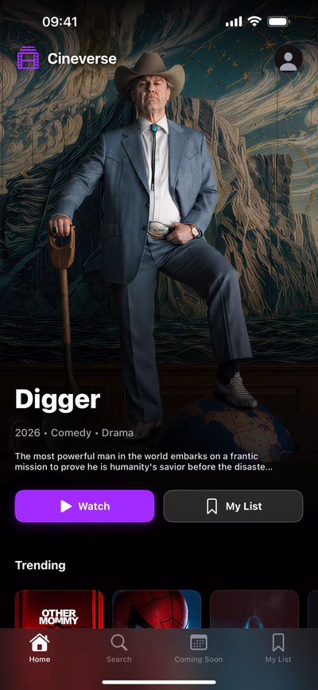
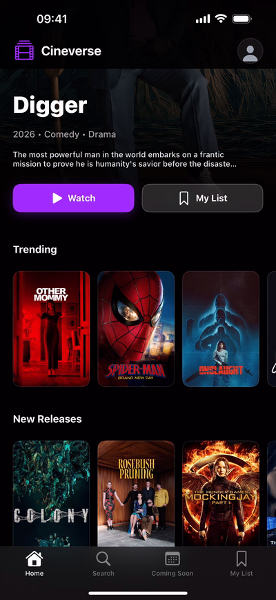
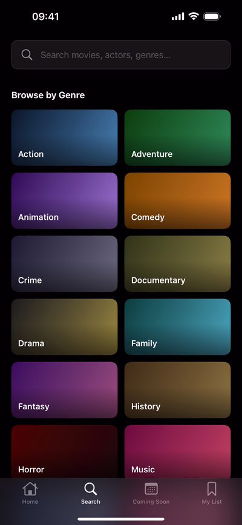
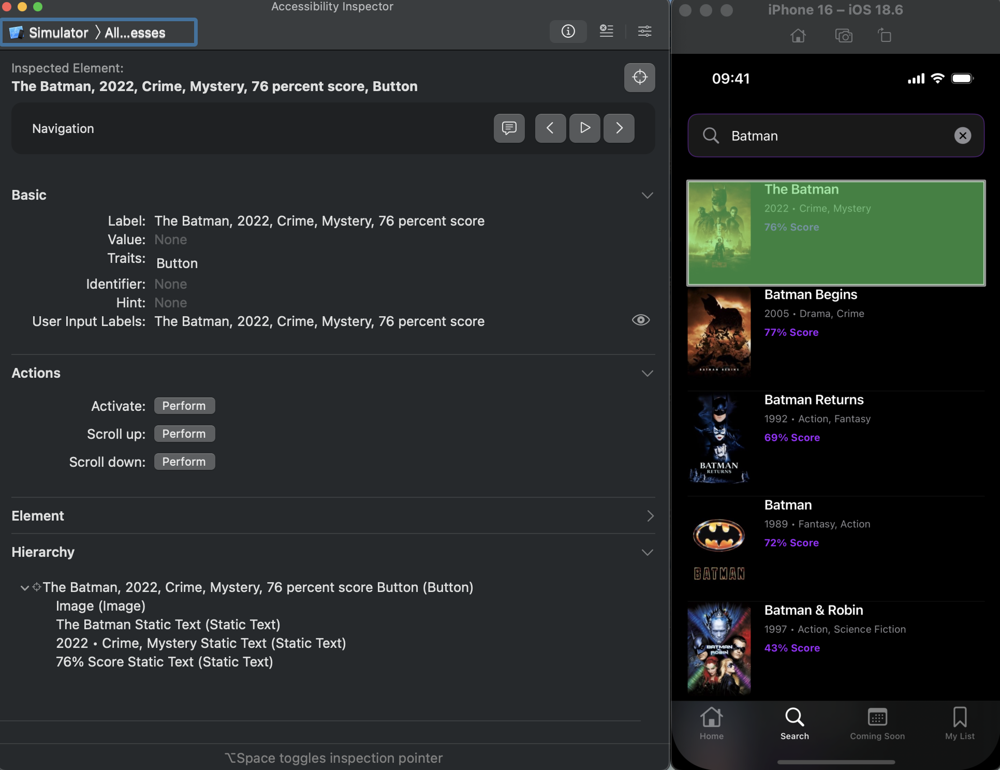

# Cineverse

**A SwiftUI movie browser on the TMDB API.**


<p align="center">
  
  
</p>
<p align="center"><sub>
  <b>Parallax</b> — the backdrop drifts behind the scroll and stretches on pull-down ·
  <b>Hero transition</b> — the poster flies from Home to Detail and back
</sub></p>

## Highlights

- **MVVM with the data behind protocols.** Home, Search and Detail each have a repository protocol,
  a TMDB remote data source and a preview repository, so view models are tested against fakes,
  never the network. → [`Features/Detail/Data/`](Cineverse/Features/Detail/Data)
- **Networking without third-party libraries.** A small `HTTPClient` protocol over `URLSession`, a
  request builder and typed errors, with an `HTTPClientSpy` in the tests. Home loads its rows
  concurrently with `async let`, and one failing row doesn't take the screen down. →
  [`Shared/Networking/`](Cineverse/Shared/Networking) ·
  [`DefaultHomeRepository`](Cineverse/Features/Home/Data/DefaultHomeRepository.swift)
- **Hero transition, Home → Detail.** The poster frame travels between screens through a
  `PreferenceKey`; `DetailHeroAnimator` and `DetailHeroCoordinator` drive it. A small pure policy
  decides whether it runs: only from a poster card, with a valid frame, and with Reduce Motion off.
  → [`Features/Main/`](Cineverse/Features/Main) ·
  [`DetailPosterHeroTransitionPolicy`](Cineverse/Features/Detail/Models/DetailPosterHeroTransitionPolicy.swift)
- **Parallax on Home.** The backdrop drifts slower than the scroll and stretches on pull-down. The
  math sits in `HeroLayoutMetrics`, tested apart from the view. →
  [`HeroLayoutMetrics.swift`](Cineverse/Features/Home/Views/Components/HeroLayoutMetrics.swift) ·
  [`HeroLayoutMetricsTests`](CineverseTests/HeroLayoutMetricsTests.swift)
- **Observation and Swift Concurrency.** `@Observable` instead of `ObservableObject`, and
  `async/await` throughout.
- **Accessibility.** Labels on interactive views; search rows and poster cards keep the native
  Button trait (checked in Accessibility Inspector). Reduce Motion respected.
- **Localized.** English and pt-BR, plurals included, via `String(localized:)`. TMDB content follows
  the app's language (`pt-BR`, since bare `pt` returns European Portuguese).

## Search

Browse by genre or search by title. Genre results paginate as you scroll. →
[`Features/Search/`](Cineverse/Features/Search)

<p align="center">
  
  
</p>
<p align="center"><sub>
  <b>Genre grid</b> — one gradient per genre ·
  <b>Genre results</b> — the banner title collapses into the nav bar as you scroll
</sub></p>

**Accessibility.** Accessibility Inspector on a search result row: one combined label, Button trait. →
[`SearchResultRowView.swift`](Cineverse/Features/Search/Views/Components/SearchResultRowView.swift)

<p align="center">
  
</p>

## Architecture

The app uses MVVM and is organized by feature. Code shared by two or more features goes in `Shared/`.
Home, Search and Detail use the same folder layout:

```
Features/<Feature>/
  Models/                         # domain models + *+Mocks.swift, pure-logic *Policy types
  ViewModels/                     # @Observable state
  Views/  (+ Views/Components/)   # SwiftUI screens and feature-local components
  Data/
    <Feature>Repository.swift             # protocol
    Default<Feature>Repository.swift      # production
    <Feature>RemoteDataSource.swift       # protocol
    TMDB<Feature>RemoteDataSource.swift   # TMDB implementation
    Preview<Feature>Repository.swift      # preview / test double
```

The four features are Home, Search, Detail and Main. Main has no data layer: it holds the tab bar and
the hero animator that runs across screens. `Shared/` holds networking, reusable components,
`DesignSystem.swift`, extensions and shared models.

Constants live in `private enum Layout` inside views (geometry), `private enum Constants` in view
models and data types, and `DesignSystem` for tokens shared across features.

### Scope

Not covered: video playback, deep links, state restoration and user accounts. The Play button is
visual only, and TMDB is used read-only, with no login.

## Tech stack

| Area | Choice |
|------|--------|
| UI | SwiftUI (iOS 18+) |
| State | `@Observable` |
| Concurrency | Swift Concurrency (`async/await`) |
| Networking | Custom `HTTPClient` + `URLSession` |
| Images | [Kingfisher](https://github.com/onevcat/Kingfisher) (disk cache, placeholders, retries) |
| Tests | Swift Testing (`@Test`, `#expect`) |
| Project gen | XcodeGen |
| Lint | SwiftLint |

## Testing

Tests use Swift Testing and cover networking, the data layer, view models and the pure-logic
policies. Test doubles (`HTTPClientSpy` and fakes) keep them off the network. A typical policy test:
[`DetailOverviewToggleVisibilityPolicyTests`](CineverseTests/Features/Detail/Models/DetailOverviewToggleVisibilityPolicyTests.swift).

After `xcodegen generate` (see Getting started), run them with ⌘U in Xcode, or from the terminal with
any iPhone simulator you have (`xcrun simctl list devices`):

```bash
xcodebuild test -project Cineverse.xcodeproj -scheme Cineverse \
  -destination 'platform=iOS Simulator,name=<your iPhone simulator>'
```

## Getting started

```bash
# Requires Xcode 16+ (iOS 18 SDK) and Homebrew
brew install xcodegen
cp Config/Secrets.xcconfig.example Config/Secrets.xcconfig   # paste your TMDB token
xcodegen generate
open Cineverse.xcodeproj   # pick any iPhone simulator, ⌘R
```

Optional: `brew install swiftlint` to lint on every build. `bash build.sh` regenerates the project, lints (strict) and builds for an iPhone 16 simulator.

**TMDB token.** Get a free v4 *read access token* at themoviedb.org → Settings → API. The token goes
from `Secrets.xcconfig` into `Info.plist` at build time, and `TMDBEnvironment.swift` reads it at
runtime. It is never in source code, and `Config/Secrets.xcconfig` is git-ignored. Without a token the app still
builds, but every TMDB request fails.

## Where to start reading

- **Most-worked feature:** [`Features/Detail/`](Cineverse/Features/Detail) — My List, synopsis toggle, hero
  poster; its hero transition lives in [`Features/Main/`](Cineverse/Features/Main) and swipe-to-dismiss in
  [`SwipeToDismissModifier`](Cineverse/Shared/Components/SwipeToDismissModifier.swift).
- **Networking pattern:** [`Shared/Networking/`](Cineverse/Shared/Networking).
- **Design tokens:** [`Shared/Utils/DesignSystem.swift`](Cineverse/Shared/Utils/DesignSystem.swift).

## Contact

Built by Pedro Pieragnoli, an iOS engineer who spent 4.5 years at IBM on the Itaú banking app. Open
to remote iOS roles, contract or full-time:\
[pedropieragnoli.dev@gmail.com](mailto:pedropieragnoli.dev@gmail.com) ·
[LinkedIn](https://www.linkedin.com/in/pedropieragnoli)

## Attribution

This product uses the TMDB API but is not endorsed or certified by TMDB.


## License

MIT — see [LICENSE](LICENSE).
